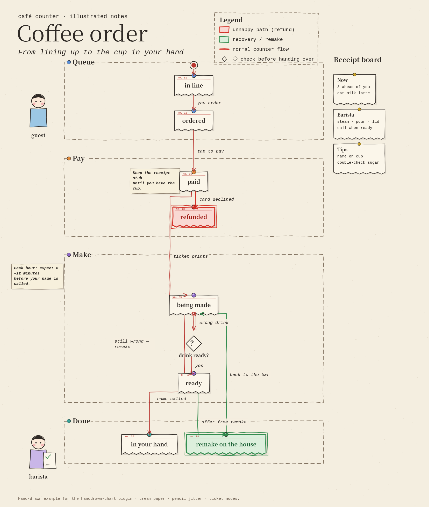

# handdrawn-chart

Cream-paper, pencil-jitter **statechart / diagram** renderer for [Claude Code](https://code.claude.com/docs/en/plugins/create).



**Node built-ins only** (no `npm install`). Outputs SVG + static HTML; PNG via Chrome headless.

## Install / load

```bash
claude --plugin-dir /path/to/handdrawn-plugin
```

Then run the skill `/handdrawn-chart:handdrawn-chart` or the slash command `/handdrawn`.

Validate (when Claude Code CLI is available):

```bash
claude plugin validate /path/to/handdrawn-plugin
```

## Quick start

From the plugin root:

```bash
node draw.mjs --self-test-wrap
node draw.mjs examples/coffee-order.json --out out --name coffee-order
./render.sh out coffee-order
node check-text.mjs examples/coffee-order.json examples/coffee-order.required.txt --svg out/coffee-order.svg
```

Open `out/coffee-order.html` or `out/coffee-order.png`.

Environment:

- `CHROME` — browser binary for `render.sh` (default `/usr/bin/google-chrome`, else macOS Google Chrome.app).

## JSON schema (summary)

| Key | Purpose |
| --- | --- |
| `title` | `{ kicker, title, subtitle }` |
| `groups` | `{ id, label, color, layout?: "column"\|"row" }[]` |
| `nodes` | `{ id, group?, label, sub?, kind?, color? }[]` — kinds: `normal\|bug\|fix\|decision\|start\|chip` |
| `edges` | `{ from, to, label?, style?: "normal\|bug\|fix\|muted" }[]` |
| `notes` | handwritten slips `{ text, group?\|near?, side? }` |
| `legend` | `{ swatch\|color\|kind, text }[]` |
| `sidebar` | `{ title, panels:[{ title, lines }] }` |
| `illustrations` | `{ kind: person\|programmer\|scorer, near, side? }` |
| `footer` | footer string |
| `seed` / `width` | PRNG seed; main column width |
| `legendTitle` | legend heading (default `Legend`) |
| `illustrations[].caption` | optional caption under a figure |

Layout is automatic (longest-path ranks inside groups). Labels wrap: Latin/number runs stay intact; closing punctuation does not start a line.

Full field notes live in `skills/handdrawn-chart/SKILL.md`.

## Layout of this plugin

```
.claude-plugin/plugin.json
skills/handdrawn-chart/SKILL.md
commands/handdrawn.md
draw.mjs
render.sh
check-text.mjs
examples/coffee-order.json
examples/coffee-order.required.txt
assets/example.png
LICENSE
README.md
```

## License

MIT — copyright the authors.
